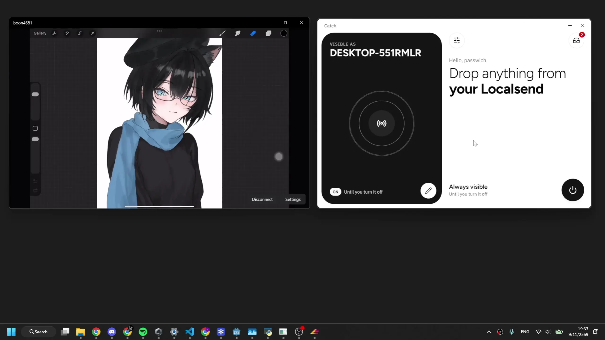
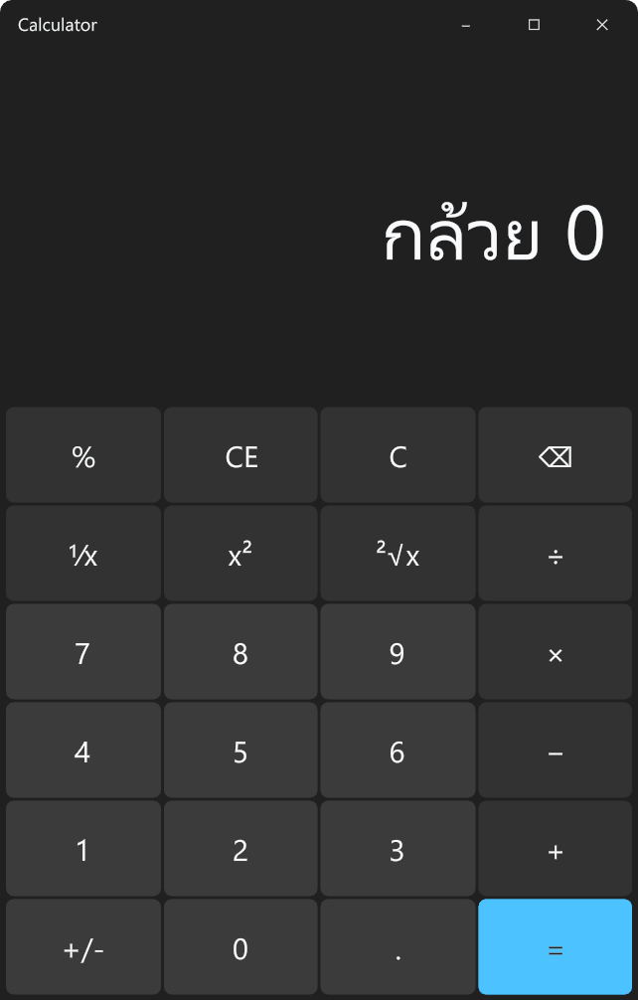

# Banana

Me try to build UI runtime. Some what of a stupid man myself to build this.

Banana is a framework that aim to make things easier for create high-level ui with low-memory usage app; there is no JavaScript engine and no browser inside it.

### Built with banana

banana compiler (still in an internal use) emit weird odin cuz odin doesn't have closures, every procedure has isolated stack frames make it hard to passing variables around.
So banana emit odin with Context object and passing it around to every function that needs to access variables.

Security? - f*ck that who cares.
- In this current stage of the project just drop security.

Banana aim to have all platform that its support render the same output, low memory footprints (NOTE: if you use window and see 100MB of ram usage that is normal for this os)

### Goal

Banana doesn't try to replace odin, its just a language to write together. UI is hard and when you do a lot of context and state, its kinda annoy to work with.

### Why not Clay lib?

First when i start this project i didn't know clay existed, im too disconnected from the world. Also after see its api, i think my head like to wrap around what i do in js more than imgui or microui api-style.

### Why use odin?

Cuz i just want a language ready to go, rust is just a pain in the ass to write (not fun) and rust-analyzer is slow as f*ck, and i need to use a lot of c-lib and rust is not gonna cut it with their unsafe pain that ghost me.

Who argue that rust is not hard to write, ok smart guy thank for the opinion but i dont care.

Golang? too painful to use with c-lib.

C++? f*ck that i hate c++, c is a good language btw but to use for this project, Nah.

I haven't try c3 yet, maybe i might rewrite this project in c3 if its not that painful.

But i have a take on odin, odin is quite a good language i guess? but it have some inconvenient things, like i hate to have a gajillion files in the same folder, i don't know how to organize them properly (my-lack of skills maybe?).

### License

MIT
